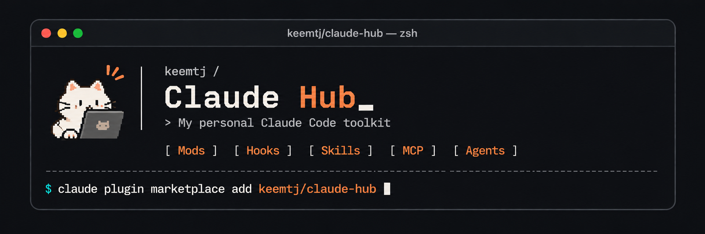

<p align="center">
  
</p>

<p align="center">
  A personal hub of Claude Code assets — mods, hooks, skills, MCP connections and agents.<br>
  Every asset's source lives here, and each one installs with a single command.
</p>

<p align="center">
  <a href="LICENSE"></a>
  
  
</p>

<p align="center"><a href="README.md">한국어</a> | <b>English</b></p>

## Quickstart

In Claude Code:

```sh
/plugin marketplace add keemtj/claude-hub
/plugin install gif-mod@claude-hub
```

Then run the asset's command, here `/gif-mod`. Add any other asset the same way with `/plugin install <name>@claude-hub`.

## Contents

- [What's in the hub](#whats-in-the-hub)
- [Mods](#mods)
- [Hooks, skills, MCP, agents, plugins](#hooks-skills-mcp-agents-plugins)
- [Managing installed assets](#managing-installed-assets)
- [Building and contributing](#building-and-contributing)
- [License](#license)

## What's in the hub

Each folder is a standalone Claude Code plugin. A name ends with its kind, so you can tell what an asset is, and how to use it, from its name alone.

| Kind | Suffix | What it is | How you use it |
|---|---|---|---|
| Mod | `-mod` | Changes Claude Code's own interface or behavior: a pane beside the chat, a band above the prompt, a slash command | Run its slash command, which matches its name |
| Hook | `-hook` | Runs a shell command on a Claude Code event, such as before a tool call or after each prompt | Works on its own once installed |
| Skill | `-skill` | Teaches Claude a procedure, which it loads when a task calls for it | Ask for the task, or run `/<skill>` |
| MCP | `-mcp` | Connects Claude to an external tool or service through an MCP server | Its tools appear to Claude once installed |
| Agent | `-agent` | A subagent with its own role and tools | Claude delegates to it, or you ask for it |

Slash command completion matches anywhere in a name, so typing `/mod` lists every mod you have installed. Each kind has its own folder, whose README says how to make one (layout, required files, checks). The hub has mods only for now; the other kinds are on the way.

## Mods

Mods draw with Claude Code's own rendering engine and use no model tokens. How to make one: [mods/README.en.md](mods/README.en.md).

### workflow-mod

<!-- preview: mods/workflow-mod/media/preview.gif -->

Follow a running workflow at a glance. A side pane shows the workflow's name, a color per phase and each agent's state (◌ waiting, ● running, ✔ done, ✘ failed), with a character walking along. Between runs, Clawd floats among the stars.

- **Command:** `/workflow-mod` opens the pane, `/workflow-mod close` closes it. It also opens on its own when a workflow starts, if the terminal is 144 columns or wider.
- [Details](mods/workflow-mod/README.en.md)

### meditate-mod

<!-- preview: mods/meditate-mod/media/preview.gif -->

A moment of calm above the prompt. An astronaut Clawd, drawn from Claude Code's own logo, drifts among dotted stars, a crescent moon and a ringed planet.

- **Command:** `/meditate-mod` toggles it; `/meditate-mod on` and `/meditate-mod off` set it.
- If you fold the band with `[-]`, click the `▸ plugin panel hidden` line to bring it back.
- [Details](mods/meditate-mod/README.en.md)

### accounts-mod

<!-- preview: mods/accounts-mod/media/preview.gif -->

Which account is this session really using? A side pane lists the services the session has touched (git, GitHub, Vercel, AWS, Codex, Claude and more, grouped by category) with every account signed in to each, marking the active one.

- **Command:** `/accounts-mod` opens it; `refresh` and `close` as arguments.
- Tokens and keys are never shown or stored, and remote addresses are reduced to host and path.
- [Details](mods/accounts-mod/README.en.md)

### ports-mod

<!-- preview: mods/ports-mod/media/preview.gif -->

Which ports did this session leave open? A side pane lists the TCP ports held by processes this session started, dev servers and MCP servers included, with an open link for local ones. It refreshes every 5 seconds while open and after each shell command.

- **Command:** `/ports-mod` opens it, `/ports-mod close` closes it.
- Secret-looking values in process arguments (`--token`, `--password`, `api_key=`) are masked.
- [Details](mods/ports-mod/README.en.md)

### inventory-mod

<!-- preview: mods/inventory-mod/media/preview.gif -->

Everything installed, in one place. Three tabs list plugins, skills and MCP servers, and let you switch them off: plugins for all sessions, skills and MCP servers for this session only.

- **Command:** `/inventory-mod` opens it, `/inventory-mod close` closes it.
- [Details](mods/inventory-mod/README.en.md)

### gif-mod

<!-- preview: mods/gif-mod/media/preview.gif -->

A GIF beside your work, and another one on refresh. It starts with cats; with your own GIPHY API key you can search for anything else, and the last search is kept for next time. Without a key it shows cats from cataas.com with a developer line on top.

- **Command:** `/gif-mod` opens it, `/gif-mod <search>` searches (or type in the pane's search field), `/gif-mod close` closes it.
- **Optional setting:** a GIPHY API key, entered with `/plugin configure gif-mod@claude-hub` and kept in your keychain.
- [Details and third-party terms](mods/gif-mod/README.en.md)

### preview-mod

<!-- preview: mods/preview-mod/media/preview.gif -->

See what you pasted, beside the prompt. The pictures folded into `[Image #N]` and the long texts folded into `[Pasted text #N +M lines]` show up in a side pane as you paste them, whether pasted or dropped from Finder, and leave when you send or delete them.

- **Command:** `/preview-mod` opens it, `/preview-mod close` closes it. It opens on its own when you paste something.
- [Details](mods/preview-mod/README.en.md)

## Hooks, skills, MCP, agents, plugins

None yet. Each folder says how to make one: [hooks](hooks/README.en.md), [skills](skills/README.en.md), [mcp](mcp/README.en.md), [agents](agents/README.en.md), [plugins](plugins/README.en.md).

## Managing installed assets

From a terminal:

```sh
claude plugin marketplace update claude-hub     # fetch the latest versions
claude plugin disable <name>@claude-hub         # turn one off, keep it installed
claude plugin enable <name>@claude-hub
claude plugin uninstall <name>@claude-hub
```

After installing, updating or changing settings, run `/reload-plugins` in a running session.

## Building and contributing

To work on the hub, clone it and add the folder itself as a marketplace. Installed assets then read the folder directly, so an edit takes effect after `/reload-plugins`, with no reinstall.

```sh
git clone https://github.com/keemtj/claude-hub
claude plugin marketplace add ./claude-hub
claude plugin validate ./claude-hub/mods/<name>   # check a plugin
claude plugin test ./claude-hub/mods/<name>       # run its tests
```

Issues and pull requests are welcome. Work happens on `develop`, and each change reaches `main` through its own pull request. The rules for naming, layout, versions and handling secrets are in [docs/conventions.md](docs/conventions.en.md).

## License

[MIT](LICENSE). Some assets fetch content from third-party services at run time; each asset's README states the terms that apply.
