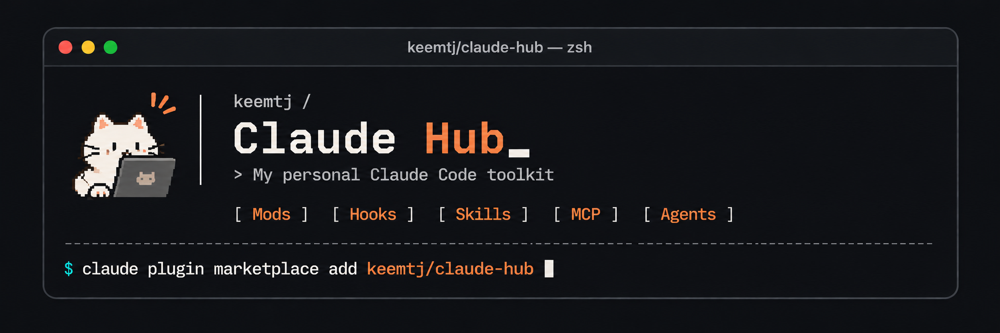

<p align="center">
  
</p>

<p align="center">
  Claude Code 자산(mod, hook, skill, MCP 연결, agent)을 모아 둔 개인 허브입니다.<br>
  모든 자산의 소스가 이 저장소에 있고, 명령 한 줄로 설치됩니다.
</p>

<p align="center">
  <a href="LICENSE"></a>
  
  
</p>

<p align="center"><b>한국어</b> | <a href="README.en.md">English</a></p>

## 빠르게 시작하기

Claude Code에서 다음을 입력합니다.

```sh
/plugin marketplace add keemtj/claude-hub
/plugin install gif-mod@claude-hub
```

그다음 자산의 명령을 실행합니다. 이 예에서는 `/gif-mod`입니다. 다른 자산도 `/plugin install <이름>@claude-hub`로 같은 방법으로 설치합니다.

## 목차

- [허브에 있는 것](#허브에-있는-것)
- [Mod](#mod)
- [Hook, Skill, MCP, Agent, Plugin](#hook-skill-mcp-agent-plugin)
- [설치한 자산 관리](#설치한-자산-관리)
- [개발과 기여](#개발과-기여)
- [라이선스](#라이선스)

## 허브에 있는 것

폴더 하나가 독립된 Claude Code 플러그인입니다. 이름 끝에 종류가 붙어 있어서, 이름만 보고도 무엇이고 어떻게 쓰는지 알 수 있습니다.

| 종류 | 접미사 | 무엇인가 | 쓰는 법 |
|---|---|---|---|
| Mod | `-mod` | Claude Code 자체의 화면이나 동작을 바꿉니다. 대화 옆 패널, 프롬프트 위 띠, 슬래시 명령 같은 것입니다 | 이름과 같은 슬래시 명령을 실행합니다 |
| Hook | `-hook` | 도구 호출 전, 프롬프트를 보낼 때 같은 Claude Code 이벤트마다 셸 명령을 실행합니다 | 설치하면 알아서 동작합니다 |
| Skill | `-skill` | Claude에게 작업 절차를 알려 줍니다. 필요한 작업이 오면 Claude가 불러 씁니다 | 그 작업을 요청하거나 `/<스킬>`을 실행합니다 |
| MCP | `-mcp` | MCP 서버를 통해 Claude를 외부 도구나 서비스와 연결합니다 | 설치하면 Claude가 그 도구를 쓸 수 있습니다 |
| Agent | `-agent` | 역할과 도구가 정해진 서브에이전트입니다 | Claude가 일을 맡기거나, 직접 요청합니다 |

슬래시 명령 자동완성은 이름의 어느 부분이든 맞춰 찾습니다. 그래서 `/mod`만 입력해도 설치한 mod가 모두 뜹니다. 종류마다 폴더가 있고, 각 폴더의 README에 그 종류를 만드는 방법(구조, 꼭 있어야 하는 파일, 확인 방법)이 있습니다. 지금은 mod만 있고, 다른 종류도 차례로 더할 예정입니다.

## Mod

mod는 Claude Code 자체의 그리기 엔진으로 화면을 그리므로 모델 토큰을 쓰지 않습니다. 만드는 방법은 [mods/README.md](mods/README.md)에 있습니다.

### workflow-mod

<!-- preview: mods/workflow-mod/media/preview.gif -->

돌고 있는 워크플로를 한눈에 따라갑니다. 옆 패널에 워크플로 이름, 단계별 색, 에이전트별 상태(◌ 대기, ● 진행, ✔ 완료, ✘ 실패)가 나오고, 캐릭터가 함께 걸어갑니다. 워크플로가 없을 때는 별 사이에 Clawd가 떠다닙니다.

- **명령:** `/workflow-mod`로 열고 `/workflow-mod close`로 닫습니다. 터미널 폭이 144칸 이상이면 워크플로가 시작될 때 알아서 열립니다.
- [자세히](mods/workflow-mod/README.md)

### meditate-mod

<!-- preview: mods/meditate-mod/media/preview.gif -->

프롬프트 위에서 잠깐 쉬어 갑니다. Claude Code 로고로 그린 우주인 Clawd가 점으로 찍은 별, 초승달, 고리 행성 사이를 떠다닙니다.

- **명령:** `/meditate-mod`로 켜고 끕니다. `/meditate-mod on`, `/meditate-mod off`로 정할 수도 있습니다.
- 띠를 `[-]`로 접었다면 `▸ plugin panel hidden` 줄을 클릭해 다시 펼칩니다.
- [자세히](mods/meditate-mod/README.md)

### accounts-mod

<!-- preview: mods/accounts-mod/media/preview.gif -->

이 세션이 실제로 어떤 계정을 쓰고 있을까요? 옆 패널에 세션이 쓴 서비스(git, GitHub, Vercel, AWS, Codex, Claude 등)를 분류별로 보여 주고, 서비스마다 로그인된 계정을 모두 나열한 뒤 활성 계정을 표시합니다.

- **명령:** `/accounts-mod`로 엽니다. 인자로 `refresh`, `close`를 씁니다.
- 토큰과 키는 화면에 보여 주거나 기록하지 않고, 원격 저장소 주소는 호스트와 경로만 보여 줍니다.
- [자세히](mods/accounts-mod/README.md)

### ports-mod

<!-- preview: mods/ports-mod/media/preview.gif -->

이 세션이 어떤 포트를 열어 두었을까요? 옆 패널에 이 세션이 띄운 프로세스(개발 서버, MCP 서버 포함)가 열어 둔 TCP 포트를 보여 주고, 로컬 주소에는 열기 링크를 붙입니다. 패널이 열려 있는 동안 5초마다, 그리고 셸 명령이 끝날 때마다 다시 확인합니다.

- **명령:** `/ports-mod`로 열고 `/ports-mod close`로 닫습니다.
- 프로세스 실행 인자 중 비밀로 보이는 값(`--token`, `--password`, `api_key=`)은 가립니다.
- [자세히](mods/ports-mod/README.md)

### inventory-mod

<!-- preview: mods/inventory-mod/media/preview.gif -->

설치한 것을 한곳에서 봅니다. 탭 세 개로 플러그인, 스킬, MCP 서버를 보여 주고 끌 수 있습니다. 플러그인은 모든 세션에서, 스킬과 MCP 서버는 이 세션에서만 꺼집니다.

- **명령:** `/inventory-mod`로 열고 `/inventory-mod close`로 닫습니다.
- [자세히](mods/inventory-mod/README.md)

### gif-mod

<!-- preview: mods/gif-mod/media/preview.gif -->

작업 옆에 GIF를 띄우고, 새로고침하면 다른 GIF로 바꿉니다. 처음에는 고양이를 보여 주고, 내 GIPHY API 키가 있으면 원하는 검색어로 찾을 수 있습니다. 마지막 검색어는 다음에도 이어서 씁니다. 키가 없으면 cataas.com 고양이에 개발 문구를 얹어 보여 줍니다.

- **명령:** `/gif-mod`로 열고, `/gif-mod <검색어>`로 검색하고(패널의 검색 입력란에 써도 됩니다), `/gif-mod close`로 닫습니다.
- **선택 설정:** GIPHY API 키. `/plugin configure gif-mod@claude-hub`로 넣으면 키체인에 저장됩니다.
- [자세히와 외부 서비스 약관](mods/gif-mod/README.md)

### preview-mod

<!-- preview: mods/preview-mod/media/preview.gif -->

프롬프트에 붙인 것을 옆에서 미리 봅니다. `[Image #N]`으로 접힌 이미지와 `[Pasted text #N +M lines]`로 접힌 긴 글을 붙이는 순간 패널에 보여 줍니다. 붙여넣기와 Finder에서 끌어다 놓기가 모두 되고, 보내거나 지우면 목록에서 빠집니다.

- **명령:** `/preview-mod`로 열고 `/preview-mod close`로 닫습니다. 무언가를 붙이면 알아서 열립니다.
- [자세히](mods/preview-mod/README.md)

## Hook, Skill, MCP, Agent, Plugin

아직 없습니다. 만드는 방법은 폴더마다 있습니다: [hooks](hooks/README.md), [skills](skills/README.md), [mcp](mcp/README.md), [agents](agents/README.md), [plugins](plugins/README.md).

## 설치한 자산 관리

터미널에서 다음을 실행합니다.

```sh
claude plugin marketplace update claude-hub     # 최신 버전 받기
claude plugin disable <이름>@claude-hub         # 설치는 두고 끄기
claude plugin enable <이름>@claude-hub
claude plugin uninstall <이름>@claude-hub
```

설치, 업데이트, 설정 변경 뒤에는 실행 중인 세션에서 `/reload-plugins`를 실행합니다.

## 개발과 기여

허브를 고치려면 저장소를 내려받아 그 폴더를 마켓플레이스로 추가합니다. 그러면 설치한 자산이 폴더를 직접 읽으므로, 다시 설치할 필요 없이 `/reload-plugins`만 하면 수정이 반영됩니다.

```sh
git clone https://github.com/keemtj/claude-hub
claude plugin marketplace add ./claude-hub
claude plugin validate ./claude-hub/mods/<이름>   # 플러그인 검사
claude plugin test ./claude-hub/mods/<이름>       # 테스트 실행
```

이슈와 PR을 환영합니다. 작업은 `develop`에서 하고, 변경마다 PR을 하나씩 올려 `main`에 머지합니다. 이름, 구조, 버전, 비밀 값 다루기 규칙은 [docs/conventions.md](docs/conventions.md)에 있습니다.

## 라이선스

[MIT](LICENSE). 일부 자산은 실행할 때 외부 서비스에서 콘텐츠를 받아 오며, 적용되는 약관은 각 자산의 README에 적혀 있습니다.
